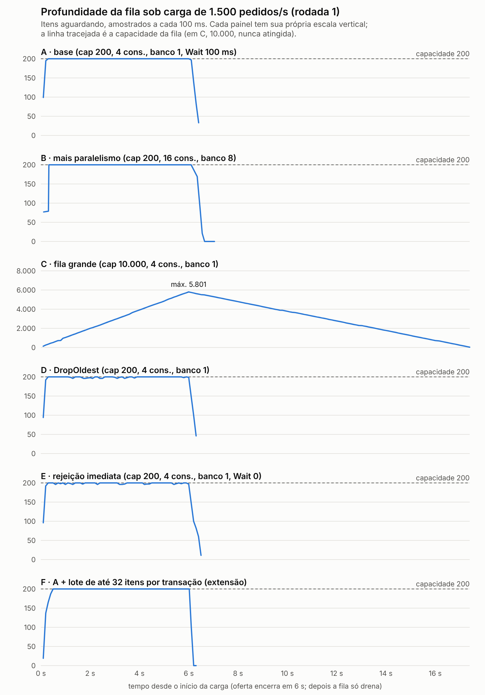

# PROGRAMAÇÃO APLICADA EM .NET — RELATÓRIO DE AULAS PRÁTICAS

**Nome:** ______________________ **RA:** ______________ **Polo:** ______________
**Local da realização da aula prática:** ______________ **Ano da postagem:** 2026

---

## Relatório 4 — Channels, SemaphoreSlim, coleções concorrentes e backpressure

**Unidade 4 – Concorrência e pipelines**

**Objetivo:** processar pedidos por uma fila limitada, controlando produtores, consumidores, acesso ao banco e encerramento da aplicação.

## 1. Entrega e ambiente

- **Repositório:** `HubPedidos/`. A pasta nova é `src/HubPedidos.Application/Processamento/`, com os seguintes tipos:
  - `ProcessarPedidoJob` (o item da fila);
  - `OpcoesFila`;
  - `FilaPedidos` (o canal limitado);
  - `LimitadorBanco` (`SemaphoreSlim`);
  - `MetricasFila` (`Interlocked`, `ConcurrentDictionary` e `System.Diagnostics.Metrics`);
  - `ConsumidorPedidos` (o `BackgroundService`).
- **Endpoints novos:** `POST /pedidos/fila` (produtor) e `GET /fila/metricas`. O `POST /pedidos/lote` passou a enfileirar.
- **Reproduzir:**
  - `dotnet test` (158 testes);
  - `dotnet run -c Release --project benchmarks/HubPedidos.Benchmarks -- experimento-fila linha-tempo.csv`.

| Item | Versão / valor |
|---|---|
| SDK / runtime | .NET SDK 10.0.114 / .NET 10.0.14 (`System.Threading.Channels` do runtime) |
| Banco | SQLite 3.53.3 em arquivo, via EF Core 10.0.14 |
| Máquina | Ubuntu 24.04.5 LTS; Xeon 2,30 GHz, 4 núcleos (VM) *(trocar pelo seu ambiente)* |
| Experimento | 1.500 pedidos/s oferecidos por 6 s; 2 ms de "trabalho externo" simulado por item (fora do semáforo); banco novo por cenário; 1 rodada de aquecimento descartada + 2 rodadas medidas |
| IDE | Visual Studio 2026 versão ______ *(preencher)* |

Configuração adotada (`appsettings.json`, seção `Fila`): `Capacidade=500`, `ModoCheio=Wait`, `TempoMaximoEsperaMs=200`, `Consumidores=4`, `LimiteBanco=1`, `TamanhoLote=32`, `Encerramento=Drenar` e `PrazoDrenagemSegundos=20`.

## 2. Resumo teórico aplicado à atividade

**Produtor/consumidor.** Quem recebe o pedido (o endpoint HTTP) não é quem o processa (o consumidor em segundo plano). A fila entre os dois absorve picos curtos. Uma fila concorrente simples (`ConcurrentQueue`) só guarda itens: o consumidor precisaria ficar consultando a fila em laço, e não haveria limite de tamanho. O `Channel<T>` acrescenta três coisas: **espera assíncrona** dos dois lados (`ReadAllAsync`, `WriteAsync`), **sinal de fim** (`Writer.Complete`) e, na versão *bounded*, um **limite de capacidade** com política definida para quando a fila enche.

**Canal limitado e backpressure.** Com capacidade fixa, a fila não cresce sem limite, e com isso a memória e a latência ficam controladas. O `FullMode` decide o que acontece quando a fila enche:

- `Wait` faz o produtor esperar. Isso é o **backpressure**: a lentidão dos consumidores "empurra de volta" para quem produz.
- `DropOldest`, `DropNewest` e `DropWrite` aceitam sempre e **descartam** algum item. O produtor não fica sabendo.

Há dois resultados diferentes aqui. **Rejeitado** significa que o produtor sabe e recebe 503. **Descartado** significa que o item foi aceito e depois se perdeu.

**SemaphoreSlim.** O `SemaphoreSlim` limita a **concorrência lógica**: quantas tarefas executam um trecho ao mesmo tempo. Ele não aumenta a capacidade do banco. Paralelismo permitido além do que o recurso aguenta só cria disputa. O **SQLite tem um único escritor**: duas transações de escrita simultâneas disputam o mesmo lock, e o `Microsoft.Data.Sqlite` repete a tentativa com espera. No SQL Server, o limite relevante é o **pool de conexões** (padrão `Max Pool Size=100`), compartilhado com as rotas HTTP de leitura. Por isso o semáforo da fila precisa ser uma fração do pool, para não esgotá-lo e causar timeout nas consultas.

**Coleções concorrentes e atomicidade.** Cada operação isolada de uma `ConcurrentDictionary` é segura. Uma **composição** de operações não é: `if (!d.ContainsKey(k)) d[k] = 0; d[k]++` é um "verifica e depois age", com uma leitura, uma soma e uma escrita separadas, e perde incrementos. `AddOrUpdate` faz a atualização de forma atômica em relação ao dicionário. O delegate pode até rodar mais de uma vez, então precisa ser puro. Para contadores simples, `Interlocked.Increment` basta. Para "máximo observado", foi usado um laço de compare-and-swap (`Interlocked.CompareExchange`).

**Cancelamento, conclusão e encerramento gracioso.** Ao parar, o host chama `StopAsync`. A sequência adotada:

1. `Writer.TryComplete()`: produtores passam a receber "encerrando" (503).
2. **Drenar**: os consumidores continuam lendo até o canal esvaziar, porque `ReadAllAsync` termina sozinho quando o writer foi completado e a fila acabou. Isso vale até o prazo do host (`HostOptions.ShutdownTimeout`).
3. Esgotado o prazo, o `stoppingToken` é cancelado. O item em andamento é interrompido e o que sobrou na fila é contado como **abandonado**.

Na política alternativa, **Abandonar**, a leitura para imediatamente.

**Fila, consumidores, pool, latência e throughput.** Pela **Lei de Little**, *L = λ·W*: os itens na fila são o throughput vezes o tempo de espera. Com o throughput limitado pelo banco, uma fila maior **não aumenta o throughput, só aumenta a espera**. Por isso a capacidade deve ser escolhida pela latência aceitável, e a rejeição controlada (503 com `Retry-After`) é melhor do que uma espera longa que o cliente nem vai aguardar.

## 3. Código-fonte, decisões e evidências

### 3.1 Canal limitado e produtor

```csharp
_canal = Channel.CreateBounded<ProcessarPedidoJob>(
    new BoundedChannelOptions(opcoes.Capacidade)
    {
        FullMode = opcoes.ModoCheio,
        SingleReader = opcoes.Consumidores == 1,
        AllowSynchronousContinuations = false, // consumidor não roda na thread da requisição
    },
    itemDropped: _ => metricas.RegistrarDescarte()); // só ocorre nos modos Drop*
```

`FilaPedidos.EnfileirarAsync` tenta `TryWrite` primeiro. Se a fila estiver cheia no modo `Wait`, há duas possibilidades:

- com `TempoMaximoEsperaMs = 0`, a recusa é imediata;
- com tempo de espera, o produtor faz `WriteAsync` com um token ligado ao cancelamento da requisição e a um limite de tempo. Se o tempo esgota, o pedido é rejeitado. Se o **cliente** cancela, a exceção é propagada e **não** conta como rejeição (testado).

**Decisões sobre o item da fila (`ProcessarPedidoJob`):**

- É um `record` imutável com o `Pedido` do domínio (também imutável), a categoria e o instante em que entrou na fila. Não guarda `DbContext` nem entidade rastreada (teste por reflexão).
- **O pedido viaja inteiro, e não só o id, de propósito.** O produtor valida e classifica, mas **não grava**. Com isso, o 503 de fila cheia não deixa nenhum pedido "órfão" no banco, e o cliente pode repetir com segurança.
- O custo dessa decisão é a **consistência eventual**: logo após o `202 Accepted`, `GET /pedidos/{id}` responde 404 até o consumidor gravar. O teste de integração espera o status `Concluido` (com prazo máximo, sem atraso fixo).
- Se o processo cair, os itens que estavam só na memória se perdem. Uma *outbox* persistida resolveria isso e fica registrada como limitação.

Evidência real (`http-e-encerramento.txt`), com a fila pausada e capacidade 2:

```
POST /pedidos/fila → 202 Accepted   Location: /pedidos/01a1be61-cf12-...
POST /pedidos/fila → 202 Accepted
POST /pedidos/fila → 503 Service Unavailable   Retry-After: 1   {"title":"Fila cheia", ...}
GET /fila/metricas → {"profundidade":2,"capacidade":2,"aceitos":2,"rejeitadosFilaCheia":1,"descartados":0, ...}
```

No `POST /pedidos/lote`, cada linha válida é enfileirada **dentro do laço de leitura do corpo**. Com `Wait`, quando os consumidores atrasam, o `await` do enfileiramento segura a leitura do corpo, e o backpressure chega até o cliente HTTP pela própria conexão.

### 3.2 Consumidores

`ConsumidorPedidos` (`BackgroundService`) inicia N tarefas que leem o mesmo canal com `ReadAllAsync`. Para cada item:

1. cria um **escopo de DI próprio**, com um `DbContext` novo, que nunca é compartilhado entre threads;
2. grava o pedido como `EmProcessamento` **dentro do semáforo**;
3. executa o processador da categoria (keyed service) **fora do semáforo**, para não ocupar o slot do banco com trabalho não relacionado;
4. marca o pedido como `Concluido` dentro do semáforo.

Sucesso, falha e duração são registrados com o `PedidoId` num *scope* de log e em mensagens geradas por `[LoggerMessage]`. **Uma falha de item não derruba o consumidor**: o `catch` registra o erro e o laço segue (testado com 5 falhas em 30 itens e um único consumidor).

**Dois bugs reais encontrados pelos testes:**

1. **Estouro de pilha.** No `LimitadorBanco.ExecutarAsync<T>`, a lambda `async ct => resultado = await operacao(ct)` é uma *expressão de atribuição* que devolve `T`. Por isso a resolução de sobrecarga escolhia o próprio método genérico de novo, numa recursão infinita, e o processo de teste caiu. A correção foi usar um corpo em bloco (`{ resultado = await ...; }`), que faz a lambda virar `Func<CancellationToken, Task>`.
2. **Filtro de cancelamento falhando.** O código usava `catch (OperationCanceledException) when (leitura.IsCancellationRequested)`, com `leitura` sendo um token *ligado* (`CreateLinkedTokenSource`). `Cancel()` executa os callbacks em **ordem inversa e de forma síncrona**. O callback do item em andamento, registrado por último, roda primeiro, e a exceção sobe pela pilha **dentro** do próprio `Cancel()`, antes de o token ligado ser marcado. Resultado: o filtro dava falso, e a tarefa dos consumidores terminava como *Canceled*. A correção foi testar os tokens de **origem** (`stoppingToken`, `_pararLeitura`).

Um terceiro ajuste veio da leitura do comportamento do `BackgroundService`. Quando o prazo de drenagem já esgotou, `base.StopAsync` recebe um token cancelado e **não espera** o `ExecuteTask`. Por isso há uma espera curta e independente (5 s) para os consumidores registrarem os itens interrompidos. Sem ela, as métricas eram lidas antes de serem atualizadas: o teste falhou 1 vez em 3 execuções.

### 3.3 Limite do banco e estado compartilhado

```csharp
public async Task ExecutarAsync(Func<CancellationToken, Task> operacao, CancellationToken ct)
{
    await _semaforo.WaitAsync(ct);          // se cancelar aqui, não obteve: não libera
    AtualizarMaximo(Interlocked.Increment(ref _emUso));
    try { await operacao(ct); }
    finally { Interlocked.Decrement(ref _emUso); _semaforo.Release(); }
}
```

- O `Release` fica no `finally` e só é chamado se o `WaitAsync` concluiu. Um teste confirma que um `WaitAsync` cancelado **não** devolve um slot que nunca obteve: `Disponiveis` continua 1, e não passa a 2.
- `MetricasFila` usa `Interlocked` nos contadores e `ConcurrentDictionary.AddOrUpdate` na contagem por categoria. Os mesmos valores são publicados em `System.Diagnostics.Metrics` (meter `HubPedidos.Fila`: contador `hub.fila.itens` por resultado, histogramas `hub.fila.espera` e `hub.fila.processamento` em ms, e medidores `hub.fila.profundidade` e `hub.fila.em_andamento`) para uso com `dotnet-counters` na Atividade 5.
- **Demonstração de check-then-act** (no experimento, 4 threads e 800.000 incrementos em 4 chaves): a versão ingênua contou **778.243 (perdeu 21.757)**, e `AddOrUpdate` contou 800.000. Na execução anterior a versão ingênua perdeu 26.311: o erro muda a cada execução, o que é típico de uma condição de corrida.
- **Observação:** cada contador é exato, mas o *retrato* de vários contadores em `GET /fila/metricas` não é atômico. Numa leitura sob carga, `processados` apareceu como 2.498 e `processadosPorCategoria` como 2.501, porque foram lidos em instantes ligeiramente diferentes.
- **Limite e pool.** Com SQLite, o `LimiteBanco` padrão é **1**, porque o banco aceita um escritor por vez e o pool do `Microsoft.Data.Sqlite` não tem teto. As leituras HTTP não passam pelo semáforo, então ele limita só o consumo da fila. Com SQL Server e pool de 100 conexões, um valor de 8 a 16 deixaria margem para as rotas de leitura. O valor seria escolhido por medição, como no 3.4.

### 3.4 Demonstração de backpressure



*Figura 1: profundidade da fila ao longo do tempo, rodada 1 (`profundidade-fila.svg/png`). Os painéis usam escalas verticais independentes porque C chega a cerca de 5.800 itens enquanto os demais param em 200.*

Resultados (rodada 1 / rodada 2; `experimento-backpressure.txt`). Em todos os cenários foram oferecidos cerca de 9.000 pedidos.

| Cenário | Throughput | Aceitos | Rejeitados (503) | Descartados (silêncio) | Espera na fila p95 / p99 | Operação no banco p99 |
|---|---|---|---|---|---|---|
| **A** cap 200, 4 cons., banco 1, Wait 100 ms | 562 / 533 /s | 3.630 / 3.460 | 5.363 / 5.535 | 0 | 540 / 545 ms · 573 / 583 ms | 1,4 / 1,8 ms |
| **B** cap 200, 16 cons., **banco 8** | **428 / 617** /s | 3.039 / 4.055 | 5.958 / 4.924 | 0 | 818 / 894 ms · 522 / 609 ms | **301 / 2,3 ms** |
| **C** cap **10.000**, 4 cons., banco 1 | 515 / 509 /s | 8.995 / 8.995 | 0 | 0 | **10,9 / 11,4 s · 11,1 / 11,5 s** | 1,7 / 1,6 ms |
| **D** cap 200, **DropOldest** | 538 / 539 /s | 8.997 / 8.997 | 0 | **5.557 / 5.563 (62%)** | 167 / 341 ms · 165 / 334 ms | 1,5 / 1,4 ms |
| **E** cap 200, Wait **0** (TryWrite) | 525 / 537 /s | 3.427 / 3.424 | 5.569 / 5.573 | 0 | 495 / 514 ms · 466 / 482 ms | 1,7 / 1,5 ms |
| **F** = A + **lote de 32** (extensão) | **913 / 913 /s** | 5.762 / 5.844 | 3.139 / 3.154 | 0 | 352 / 407 ms · 330 / 405 ms | 40 / 17 ms (por lote) |

**Leitura dos resultados:**

- **A × C (capacidade):** o throughput é praticamente o mesmo (cerca de 520 a 560/s), porque o gargalo é o processamento e não a fila. A fila de 10.000 só transformou rejeição em **espera de 11 segundos** e manteve cerca de 5.900 pedidos na memória. A fila continuou drenando até 17,5 s, muito depois do fim da oferta (Figura 1). Nenhum cliente HTTP real esperaria isso.
- **A × D (política):** `DropOldest` parece ótimo na espera (p95 de 165 ms), mas **62% dos pedidos foram descartados depois de o cliente receber 202**. Para pedidos, isso é perda silenciosa de dados. A política só é aceitável para dados descartáveis, como telemetria.
- **A × E (esperar 100 ms ou recusar na hora):** throughput e rejeições semelhantes. Esperar 100 ms ajudou pouco porque a fila ficou cheia o tempo todo (média de 193 itens). No cenário E, a Lei de Little se confirma: cerca de 190 itens ÷ cerca de 531/s ≈ 360 ms, e a mediana medida foi de 355 ms. No cenário A, a espera inclui também os até 100 ms do produtor aguardando vaga.
- **A × B (mais paralelismo):** ver 3.5.
- **A × F (lote, extensão):** gravar até 32 pedidos por transação reduziu as operações no banco de **2,0 para cerca de 0,06 por pedido**. O throughput subiu **68%** (913/s, igual nas duas rodadas), a espera p95 caiu de cerca de 555 ms para cerca de 340 ms e as rejeições caíram de cerca de 61% para cerca de 35%. Cada operação de lote é mais lenta (p99 de 17 a 40 ms), mas é feita uma vez a cada 32 pedidos. No SQLite, o custo dominante de cada escrita é confirmar a transação no disco, e o lote divide esse custo.

### 3.5 Por que aumentar o paralelismo pode piorar o banco

No cenário B, os consumidores foram de 4 para 16 e o limite do banco de 1 para 8. O resultado foi **instável**:

- **rodada 1:** 428/s (pior que A), com a operação de banco em **p99 = 301 ms**, contra 1,4 ms em A;
- **rodada 2:** 617/s, com p99 de 2,3 ms;
- na execução anterior do experimento, as rodadas deram 426/s (p99 de 155 ms) e 637/s.

O SQLite aceita um escritor por vez. Com 8 transações tentando escrever ao mesmo tempo, as que não conseguem o lock recebem `SQLITE_BUSY`, e o `Microsoft.Data.Sqlite` repete a tentativa **com espera**. Daí a cauda de centenas de milissegundos. Na média, B não ganhou throughput, piorou a cauda e ficou imprevisível. Em bancos com servidor, o mecanismo é parecido: mais conexões simultâneas significam mais disputa por locks e por I/O, e o pool se esgota para as outras rotas. **Escala-se o que é gargalo**. Aqui o gargalo era o custo por transação, e o lote (F) atacou exatamente isso.

### 3.6 Configuração escolhida

`Wait` com espera curta (200 ms), capacidade 500, 4 consumidores, `LimiteBanco = 1` e **lote de até 32**. Os motivos:

- é a única combinação **sem perda silenciosa**;
- tem latência na fila limitada a algumas centenas de milissegundos;
- quando sobrecarregada, avisa o cliente com 503 + `Retry-After`;
- e tem o melhor throughput medido.

O lote é *oportunista*: junta só o que **já está** na fila (`TryRead`, sem esperar). Com fila vazia, o comportamento é igual ao do processamento item a item.

## 4. Testes e validações obrigatórias

Resultado: **158 testes, 158 aprovados** (23 novos), sem falhas em execuções repetidas (6 seguidas antes da extensão de lote e 3 depois); lista em `docs/evidencias/atividade4/testes.txt`. Os testes usam uma "bancada" com a fila e o consumidor **reais** e um repositório falso que mede a concorrência por conta própria. Não há atrasos fixos: as esperas são por condição, com prazo.

| Validação exigida | Teste(s) |
|---|---|
| Modo `Wait`: produtor aguarda | `Modo_wait_faz_o_produtor_aguardar_ate_haver_espaco`; `Espera_esgotada_vira_rejeicao_explicita`; `Cancelamento_do_cliente_propaga_e_nao_conta_como_rejeicao` |
| Modos de descarte observados | `Modos_de_descarte_aceitam_tudo_e_descartam_conforme_a_politica` (DropOldest → restam 3,4,5; DropNewest → 1,2,5; DropWrite → 1,2,3) |
| Rejeição explícita: `TryWrite` e resposta HTTP | `Sem_espera_TryWrite_rejeita_imediatamente`; `Fila_cheia_responde_503_com_retry_after_sem_gravar` |
| Operações no banco nunca excedem o limite | `Concorrencia_no_banco_nunca_passa_do_limite` (8 consumidores, limite 3 → máximo **3**, medido pelo limitador e pelo próprio repositório); `Limitador_nao_libera_slot_que_nao_obteve`; `Limitador_libera_slot_mesmo_com_excecao` |
| Falha de um item não encerra os consumidores | `Falha_de_um_item_nao_derruba_o_consumidor_nem_perde_slot` |
| Cancelamento impede novos itens; estratégia para pendentes | `Encerramento_drenar_recusa_novos_e_processa_os_pendentes`; `Encerramento_abandonar_interrompe_e_contabiliza_os_pendentes`; `Prazo_de_drenagem_esgotado_nao_trava_o_encerramento`. Evidência real: SIGTERM com 480 itens na fila, todos os 2.998 aceitos gravados como `Concluido` |
| Nenhum pedido processado duas vezes | `Nenhum_pedido_e_processado_duas_vezes` (500 itens, 4 consumidores); `Lote_processa_todos_uma_vez...`; `Falha_no_lote_cai_para_item_a_item...` |
| Contadores corretos sob concorrência | `Metricas_por_categoria_sao_exatas_sob_concorrencia` (8 threads, 30.000 registros) |
| Item da fila imutável e sem EF | `Job_e_imutavel_e_nao_carrega_tipos_do_ef` |
| Fluxo completo HTTP → fila → banco | `Pedido_enfileirado_e_processado_e_gravado_como_concluido` |

Todos os testes do consumidor terminam verificando um **balanço**: aceitos = processados + falhas + abandonados + descartados + na fila + em andamento. Nenhum item fica sem destino conhecido.

### Aprimoramentos

1. **Processamento em lote, comparando throughput e latência** (extensão do roteiro): implementado com *fallback* item a item quando a transação do lote falha. Testado com repositório falso e com SQLite real (`Lote_com_item_invalido_nao_grava_nenhum` prova que a transação é desfeita por inteiro). Medido no cenário F: +68% de throughput.
2. Métricas publicadas em `System.Diagnostics.Metrics`, prontas para a Atividade 5.
3. *(Não realizados)* Filas por prioridade e idempotência persistida ficam como trabalho futuro. A idempotência também resolveria a perda de itens em memória quando o processo cai.

## 5. Referências

> Mantenha somente as fontes que você realmente consultou.

MICROSOFT. **System.Threading.Channels library**. Microsoft Learn, 2025. Disponível em: https://learn.microsoft.com/dotnet/core/extensions/channels. Acesso em: 9 nov. 2026.

MICROSOFT. **BoundedChannelFullMode Enum**. Microsoft Learn, 2025. Disponível em: https://learn.microsoft.com/dotnet/api/system.threading.channels.boundedchannelfullmode. Acesso em: 9 nov. 2026.

MICROSOFT. **SemaphoreSlim Class**. Microsoft Learn, 2025. Disponível em: https://learn.microsoft.com/dotnet/api/system.threading.semaphoreslim. Acesso em: 9 nov. 2026.

MICROSOFT. **ConcurrentDictionary&lt;TKey,TValue&gt;.AddOrUpdate**. Microsoft Learn, 2025. Disponível em: https://learn.microsoft.com/dotnet/api/system.collections.concurrent.concurrentdictionary-2.addorupdate. Acesso em: 9 nov. 2026.

MICROSOFT. **Background tasks with hosted services in ASP.NET Core**. Microsoft Learn, 2025. Disponível em: https://learn.microsoft.com/aspnet/core/fundamentals/host/hosted-services. Acesso em: 9 nov. 2026.

MICROSOFT. **Cancellation in managed threads**. Microsoft Learn, 2025. Disponível em: https://learn.microsoft.com/dotnet/standard/threading/cancellation-in-managed-threads. Acesso em: 9 nov. 2026.

MICROSOFT. **Microsoft.Data.Sqlite: database errors and busy handling**. Microsoft Learn, 2025. Disponível em: https://learn.microsoft.com/dotnet/standard/data/sqlite/database-errors. Acesso em: 9 nov. 2026.

LITTLE, J. D. C. A proof for the queuing formula: L = λW. **Operations Research**, v. 9, n. 3, p. 383-387, 1961.
