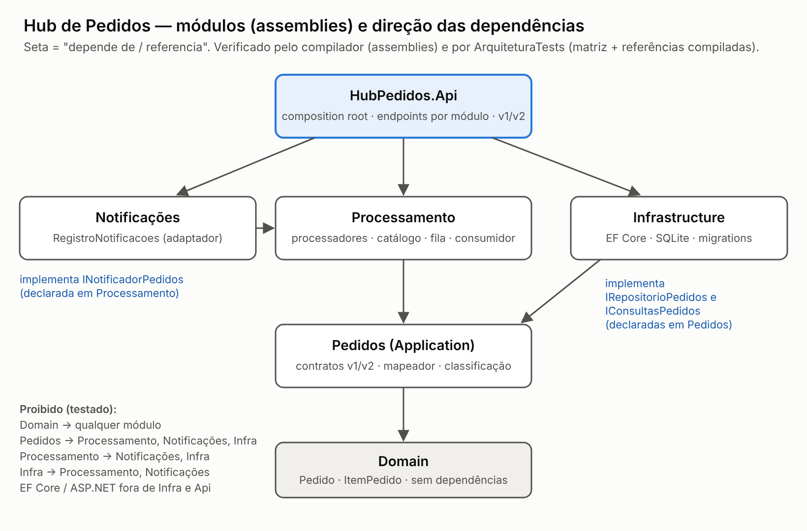

# PROGRAMAÇÃO APLICADA EM .NET — RELATÓRIO DE AULAS PRÁTICAS

**Nome:** ______________________ **RA:** ______________ **Polo:** ______________
**Local da realização da aula prática:** ______________ **Ano da postagem:** 2026

---

## Relatório 6 — Modularização, IoC, fronteiras e versionamento compatível de APIs

**Unidade 6 – Arquitetura aplicada**

**Objetivo:** separar responsabilidades do Hub e evoluir o contrato HTTP sem romper um cliente que depende da versão anterior.

## 1. Entrega e ambiente

- **Repositório:** `HubPedidos/`. Mudanças desta atividade:
  - novos assemblies `src/HubPedidos.Processamento` e `src/HubPedidos.Notificacoes`;
  - API reorganizada em `Modulos/` (Pedidos, Processamento, Notificações);
  - `Program.cs` reduzido a um *composition root* de 45 linhas;
  - documentação: `docs/arquitetura/modulos.svg` (diagrama), `docs/adr/0001` a `0004` (decisões) e `docs/api/versionamento.md` (política e matriz de mudanças).
- **Reproduzir:** `dotnet test` (185 testes). A API documenta cada versão em `/openapi/v1.json` e `/openapi/v2.json`.

| Item | Versão |
|---|---|
| SDK / runtime | .NET SDK 10.0.114 / .NET 10.0.14 |
| Pacotes novos | Microsoft.AspNetCore.OpenApi 10.0.14; Microsoft.Extensions.DependencyInjection.Abstractions e Configuration.Binder 10.0.14 (nos módulos) |
| Banco | SQLite 3.53.3 / EF Core 10.0.14 |
| IDE | Visual Studio 2026 versão ______ *(preencher)* |

## 2. Resumo teórico aplicado à atividade

**Módulo como fronteira.** Um módulo é uma fronteira de **responsabilidade**: tem dono, contratos públicos e dependências explícitas. Organizar por pasta não é o mesmo que controlar a dependência. Duas pastas no mesmo projeto podem se referenciar livremente, e a fronteira passa a depender de disciplina. Aqui, cada módulo é um **assembly**: o compilador não deixa usar um tipo de outro módulo sem referência explícita, e um teste impede adicionar referências proibidas.

**Inversão de controle e composition root.** As classes declaram o que precisam no construtor, e um único ponto (o `Program.cs`) decide qual implementação usar. Dois riscos aparecem nesse modelo:

- **Service locator:** pedir serviços a um `IServiceProvider` dentro da regra de negócio. Isso esconde dependências e dificulta testes.
- **Dependência cativa:** um singleton que recebe um serviço scoped no construtor. O serviço scoped (por exemplo, o `DbContext`) passa a viver para sempre e a ser compartilhado entre requisições e threads.

Os **tempos de vida** são: *singleton* (uma instância por aplicação), *scoped* (uma por requisição ou escopo) e *transient* (uma por resolução).

**Boundaries, contratos internos e eventos.** Entre módulos circulam **contratos** (DTOs, interfaces e eventos com dados mínimos), nunca entidades nem detalhes de persistência. A interface fica no módulo que **consome** o serviço (porta) e a implementação fica fora (adaptador). Assim, quem consome não depende de quem implementa.

**Mudanças compatíveis e incompatíveis.**

- **Compatível:** adicionar um campo opcional, um endpoint novo ou um valor tolerado pelo cliente.
- **Incompatível:** remover ou renomear um campo, mudar seu **tipo**, mudar o **significado** de um valor, mudar valores de enum, mudar o status HTTP ou uma ordenação documentada.

Uma mudança de semântica sem mudança de formato, como "total" passar a incluir frete, é a mais perigosa, porque o cliente continua funcionando com o valor errado.

**Estratégias de versionamento.** A versão pode ir na URL (`/v2/`), num cabeçalho (`api-version`), na query string ou no *media type*. É preciso definir uma **política**: qual versão vale quando nenhuma é informada, o que acontece com uma versão inexistente, como avisar a depreciação (cabeçalhos `Deprecation`, RFC 9745, e `Sunset`, RFC 8594) e quando remover.

**Compatibilidade para front-ends.** O contrato publicado é uma promessa. As versões **coexistem** por um período, o **uso de cada versão é medido** (telemetria) e a remoção é **planejada** com critérios objetivos, e não por data arbitrária.

## 3. Código-fonte, decisões e evidências

### 3.1 Módulos e direção das dependências (Etapa 1)



*Figura 1: módulos (assemblies) e direção das dependências (`docs/arquitetura/modulos.svg`).*

| Módulo (assembly) | Responsabilidade | Pode depender de |
|---|---|---|
| `Domain` | entidade e *value objects* | nada |
| **Pedidos** (`Application`) | contratos v1/v2, mapeador, classificação, importação, **portas** `IRepositorioPedidos`/`IConsultasPedidos` | Domain |
| **Processamento** | processadores, catálogo, fila, consumidor, seletor, **porta** `INotificadorPedidos` | Pedidos, Domain |
| **Notificações** | `RegistroNotificacoes` (adaptador da porta) | Processamento, Pedidos, Domain |
| `Infrastructure` | EF Core/SQLite: implementa as portas de Pedidos | Pedidos, Domain |
| `Api` | *composition root* e endpoints HTTP | todos |

**Vazamento corrigido.** `MapeadorPedidos.ParaResposta` (módulo Pedidos) dependia de `ResultadoProcessamento` (módulo Processamento), uma dependência "para cima". O mapeamento passou para o Processamento (`MapeadorResultado`), junto com os DTOs que só fazem sentido lá: `PedidoEnfileiradoResponse` e `MetricasFilaResponse`.

**Portas movidas para quem consome.** `INotificadorPedidos` é declarada no Processamento, porque é ele que avisa que algo mudou, e é implementada em Notificações. Sem o módulo de notificações, vale o `NotificadorNulo` (registrado com `TryAdd`). Na Atividade 7, o SignalR entra **dentro** do módulo de Notificações sem mexer no processamento.

**A direção é verificável no projeto, e não só no diagrama:**

1. **Compilador.** Uma tentativa de usar `NotificadorNulo` dentro do módulo Pedidos falhou com `error CS0234: The type or namespace name 'Processamento' does not exist in the namespace 'HubPedidos'` (`fronteiras-verificaveis.txt`).
2. **Testes arquiteturais entre assemblies** (`ArquiteturaTests`, extensão do roteiro). A matriz acima é verificada em dois níveis: nas `<ProjectReference>` de cada `.csproj` (o que o módulo **pode** usar) e nas referências gravadas no assembly compilado (o que ele **realmente** usa). Um terceiro teste confere que cada porta é declarada no módulo consumidor e implementada só no módulo esperado. Também é verificado que EF Core, SQLite e ASP.NET não aparecem nos módulos Domain, Pedidos, Processamento e Notificações.

**O teste já pegou uma violação real.** Durante a reorganização, um `dotnet remove reference` executado com o caminho errado falhou em silêncio, e a Infrastructure continuou referenciando o Processamento. O build passava; o teste falhou com `HubPedidos.Infrastructure.csproj referencia HubPedidos.Processamento (proibido pela matriz)`. Reproduzi isso de propósito para registrar a evidência.

**Decisões registradas** em ADRs curtos, cada um com as alternativas descartadas:

- **0001:** módulos como assemblies. Descartados: pastas com teste por reflexão, que não enxerga o corpo dos métodos; e microsserviços.
- **0002:** portas declaradas por quem consome. Descartado: um projeto "Contracts" compartilhado por todos.
- **0003:** versão no segmento de URL. Descartados: cabeçalho, query string, *media type* e a biblioteca Asp.Versioning.
- **0004:** seletor de processador como único ponto de resolução por chave.

### 3.2 IoC organizado (Etapa 2)

Cada módulo tem a própria extensão de registro, e o `Program.cs` só compõe:

```csharp
builder.Host.UseDefaultServiceProvider(o => { o.ValidateOnBuild = true; o.ValidateScopes = true; });
builder.Services
    .AddModuloPedidos(builder.Configuration)
    .AddModuloProcessamento(builder.Configuration)
    .AddModuloNotificacoes()
    .AddInfraestrutura(builder.Configuration)
    .AddProblemDetails();
```

| Serviço | Tempo de vida | Justificativa |
|---|---|---|
| `CatalogoProcessadores`, `OpcoesFila`, `OpcoesImportacao`, `OpcoesEscritaHttp` | Singleton | imutáveis, montados uma vez na inicialização |
| `FilaPedidos`, `LimitadorBanco`, `MetricasFila` | Singleton | estado **compartilhado** de propósito: o teto de escrita no banco precisa ser global (Atividade 5) |
| `RegistroNotificacoes` / `INotificadorPedidos` | Singleton (a mesma instância nas duas interfaces) | guarda as notificações recentes de todas as requisições |
| `HubDbContext`, `RepositorioPedidos`, `ConsultasPedidos` | Scoped | o `DbContext` não é thread-safe; uma unidade de trabalho por requisição ou item da fila |
| Processadores (keyed) e `ISeletorProcessador` | Scoped | podem depender de serviços scoped; o seletor resolve no escopo de quem o recebeu |
| `ConsumidorPedidos` (hosted) | Singleton | cria **um escopo por item** com `IServiceScopeFactory`, em vez de capturar serviços scoped |

**Service locator removido da regra.** O endpoint de criação e o consumidor pediam `GetRequiredKeyedService<IProcessadorPedido>(categoria)` ao `IServiceProvider`. Agora recebem `ISeletorProcessador` por injeção. A resolução por chave dinâmica ficou confinada nessa única classe (`SeletorProcessadorKeyed`, ADR 0004). O endpoint também deixou de ler `IConfiguration` a cada requisição: recebe `OpcoesEscritaHttp`, montado uma vez.

**Validação do grafo** (`ComposicaoTests`):

- **Inicialização:** o host é construído com `ValidateOnBuild` e `ValidateScopes`. Um grafo inválido impede a aplicação de subir.
- **Analisador de dependência cativa.** Percorre o `IServiceCollection` final da aplicação e verifica, no construtor de cada singleton, se algum parâmetro está registrado como scoped. Resultado na aplicação: **nenhuma violação**. Um teste negativo prova que o analisador e o contêiner detectam o problema: um singleton `Cativo` recebendo um scoped `Escopado` produz `Cativo (singleton) recebe Escopado (scoped)` no analisador e `Cannot consume scoped service` no contêiner.
- **Fluxos principais:** cada categoria do catálogo resolve para o tipo declarado no atributo; as portas resolvem para as implementações da infraestrutura; scoped é a mesma instância dentro do escopo e diferente entre escopos; o módulo de notificações substitui o `NotificadorNulo`, e sem ele vale o nulo.

### 3.3 Política de versão (Etapa 3)

- **Endpoint escolhido:** `GET /pedidos/{id}` (detalhe).
- **Consumidores conhecidos:** o painel web (v1), o cliente de teste congelado (v1) e novos integradores, como ERP e aplicativo (v2).

| Item | Regra adotada |
|---|---|
| Leitura da versão | segmento de URL: `/api/v1/pedidos/{id}`, `/api/v2/pedidos/{id}` |
| Versão padrão | a rota legada `/pedidos/{id}` continua sendo **v1** |
| Versão não suportada | `GET /api/v3/...` → **400** `application/problem+json` com `"versoesSuportadas":[1,2]` e cabeçalho `api-supported-versions: 1, 2` |
| Depreciação | a v1 responde `Deprecation: @1794441600` (2026-11-12), `Sunset: Mon, 31 May 2027 00:00:00 GMT` e `Link: </api/v2/pedidos>; rel="successor-version"` |
| Documentação | um documento OpenAPI por versão (`AddOpenApi("v1")`/`("v2")` filtrando por `WithGroupName`). Evidência: o v1 lista só `/api/v1/pedidos/{id}` e o v2 só `/api/v2/pedidos/{id}`, com o schema `DinheiroV2` |

A rota de versão desconhecida usa `/api/v{versao:int}/...`. Os grupos literais `v1` e `v2` têm precedência no roteamento, então só versões inexistentes chegam ao handler de erro.

**Mudança incompatível deliberada da v2** (`docs/api/versionamento.md`):

| Campo | v1 | v2 | Compatível? |
|---|---|---|---|
| `total`, `itens[].precoUnitario`, `itens[].subtotal` | número JSON (`3000000.07`) | `{ "valor": "3000000.07", "moeda": "BRL" }` | **não** (tipo muda) |
| `criadoEmUtc` | `"2026-11-12T00:59:10.02"` (sem fuso) | `criadoEm`: `"2026-11-12T00:59:10.02+00:00"` | **não** (nome e formato) |
| demais campos, status HTTP, ordenação dos itens | — | iguais | sim |

**Motivos da mudança:**

- Um número JSON vira `double` em JavaScript e perde precisão em valores grandes. Por isso o valor vai como string.
- Uma data sem fuso é interpretada de maneiras diferentes por cada cliente.

A v2 é montada a partir do **mesmo resultado de consulta** da v1, por um adaptador (`AdaptadorPedidoV2`). Não há consulta extra, e a v1 nunca é alterada para servir à v2.

### 3.4 Compatibilidade provada (Etapa 4)

**Cliente v1 congelado** (`ClientePainelV1`). Representa o front-end e tem os **próprios tipos**, copiados do contrato publicado. Ele não reaproveita os DTOs do servidor: se o servidor mudar a v1, o cliente quebra, como quebraria um cliente real. A desserialização é **estrita** (`UnmappedMemberHandling.Disallow`): qualquer campo novo, removido ou renomeado na v1 faz o teste falhar.

Testes executados contra a aplicação que também contém a v2:

- **Formato:** o cliente v1 lê `/api/v1/pedidos/{id}` e a rota legada `/pedidos/{id}`.
- **Semântica, e não só formato:**
  - o total é a soma dos subtotais;
  - cada subtotal é quantidade × preço;
  - R$ 3.000.000,07 chega exato e é formatado como `"3.000.000,07"`;
  - `criadoEmUtc` é de fato UTC;
  - o status pertence ao conjunto conhecido.
- **Snapshot do contrato v1:** nomes e tipos JSON de cada campo de topo e de cada item batem com a lista publicada.
- **A v2 quebraria o cliente v1**, o que justifica manter a v1: apontado para `/api/v2`, o cliente v1 lança `JsonException`.

**Ciclo de vida da v1** (`docs/api/versionamento.md`). O uso por versão é contado pelo contador `hub.api.requisicoes_versionadas` (meter `HubPedidos.Api`) e exposto em `GET /api/versoes`. Na evidência: `"uso":{"v1":2,"v2":1}`. Critérios para remover a v1:

1. uso abaixo de 1% das consultas por 30 dias seguidos e nenhum consumidor conhecido ainda na v1;
2. a data de sunset (2027-05-31) foi atingida;
3. os consumidores foram avisados com 60 dias de antecedência.

Depois disso, `/api/v1` passa a responder 400 (versão não suportada) e a rota legada responde 410 por mais um ciclo antes de ser removida.

## 4. Testes e validações obrigatórias

Resultado: **185 testes, 185 aprovados** (26 novos), em execuções repetidas; lista em `docs/evidencias/atividade6/testes.txt`.

| Validação exigida | Teste(s) |
|---|---|
| Domínio compila sem referência à API ou ao EF Core | `Assembly_compilado_so_usa_dependencias_permitidas(HubPedidos.Domain)`; `Dominio_continua_sem_dependencias`; mais a matriz completa para os 6 assemblies, nos `.csproj` e nos binários (12 casos) |
| Nenhum serviço scoped capturado por singleton | `Grafo_da_aplicacao_nao_tem_dependencia_cativa`; `Analisador_e_o_conteiner_detectam_uma_dependencia_cativa_proposital` |
| v1 e v2 coexistem com contratos documentados | `Documentacao_openapi_e_separada_por_versao`; `V2_tem_a_mudanca_incompativel_documentada...`; `V1_anuncia_depreciacao_e_sucessora_e_v2_nao` |
| Cliente v1 interpreta a resposta sem mudança silenciosa de semântica | `Cliente_v1_continua_funcionando_na_aplicacao_que_tem_v2` (×2: `/api/v1` e rota legada); `Contrato_v1_e_identico_ao_publicado` |
| Versão ausente ou não suportada segue política explícita | rota legada = v1 (teste acima); `Versao_nao_suportada_segue_a_politica_explicita`; `Uso_por_versao_e_observavel` |
| Grafo de DI e fluxos | `Fluxos_principais_sao_resolvidos_com_os_tempos_de_vida_esperados`; `Sem_o_modulo_de_notificacoes_o_processamento_usa_o_notificador_nulo` |
| Notificações (novo módulo) | `Cada_pedido_concluido_gera_uma_notificacao_e_falha_no_notificador_nao_desfaz_o_processamento`; `Conclusao_pela_fila_aparece_nas_notificacoes_recentes` |

**Um erro meu que o domínio pegou.** No primeiro teste de versão, usei um preço de R$ 1.234.567,89, acima do limite de R$ 1.000.000 imposto pelo `ItemPedido` desde a Atividade 1. A API recusou com 400, corretamente. O teste foi corrigido para valores válidos e altos (R$ 999.999,99 × 3).

### Aprimoramentos

1. **Teste arquitetural automatizado entre assemblies** (extensão do roteiro), em dois níveis (`.csproj` e assembly compilado), com verificação de portas e de tecnologia proibida. **Já detectou uma violação real** durante esta atividade.
2. **Adaptador entre duas representações de pedido** (`AdaptadorPedidoV2`): traduz a representação v1 para a v2 sem alterar a v1, deixando as duas isoladas. Cobre parcialmente a extensão "adaptador anticorrupção".
3. *(Não realizado)* Geração de clientes v1 e v2 (NSwag/Kiota) e comparação das diferenças de compilação.

## 5. Referências

> Mantenha somente as fontes que você realmente consultou.

MICROSOFT. **Dependency injection in .NET: service lifetimes**. Microsoft Learn, 2025. Disponível em: https://learn.microsoft.com/dotnet/core/extensions/dependency-injection. Acesso em: 12 nov. 2026.

MICROSOFT. **Dependency injection guidelines (captive dependency, service locator)**. Microsoft Learn, 2025. Disponível em: https://learn.microsoft.com/dotnet/core/extensions/dependency-injection-guidelines. Acesso em: 12 nov. 2026.

MICROSOFT. **Generate OpenAPI documents (Microsoft.AspNetCore.OpenApi)**. Microsoft Learn, 2025. Disponível em: https://learn.microsoft.com/aspnet/core/fundamentals/openapi/aspnetcore-openapi. Acesso em: 12 nov. 2026.

MICROSOFT. **Route groups and endpoint filters in Minimal APIs**. Microsoft Learn, 2025. Disponível em: https://learn.microsoft.com/aspnet/core/fundamentals/minimal-apis/route-handlers. Acesso em: 12 nov. 2026.

IETF. **RFC 9745: The Deprecation HTTP Response Header Field**. 2025. Disponível em: https://www.rfc-editor.org/rfc/rfc9745. Acesso em: 12 nov. 2026.

IETF. **RFC 8594: The Sunset HTTP Header Field**. 2019. Disponível em: https://www.rfc-editor.org/rfc/rfc8594. Acesso em: 12 nov. 2026.

MICROSOFT. **Web API design best practices: versioning a RESTful web API**. Microsoft Learn (Azure Architecture Center), 2025. Disponível em: https://learn.microsoft.com/azure/architecture/best-practices/api-design. Acesso em: 12 nov. 2026.
